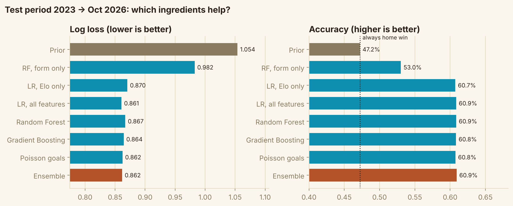
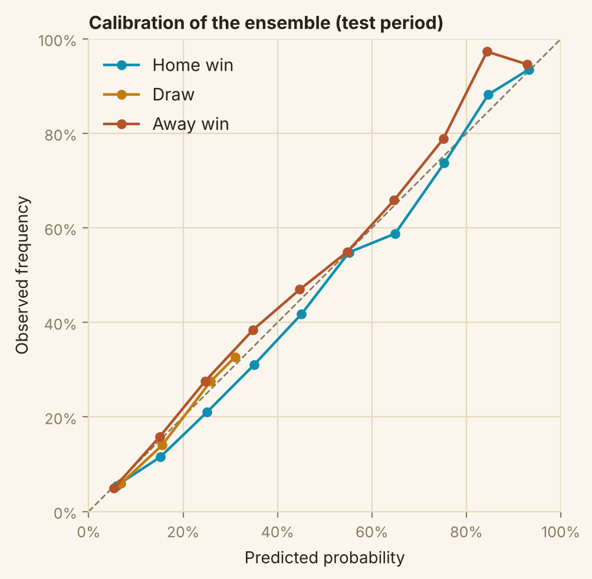
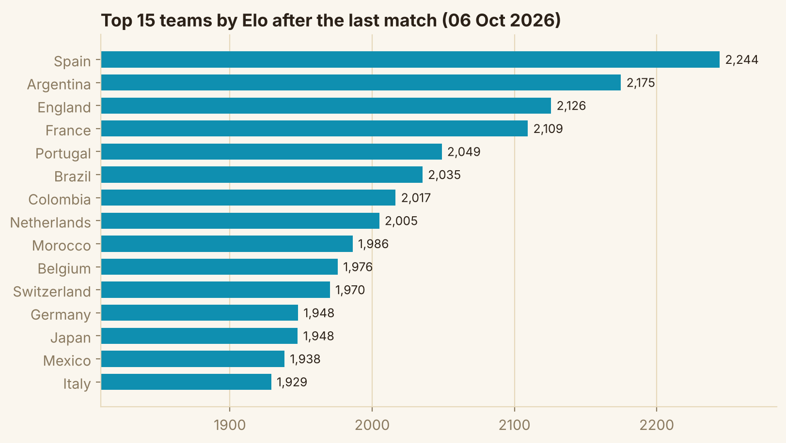
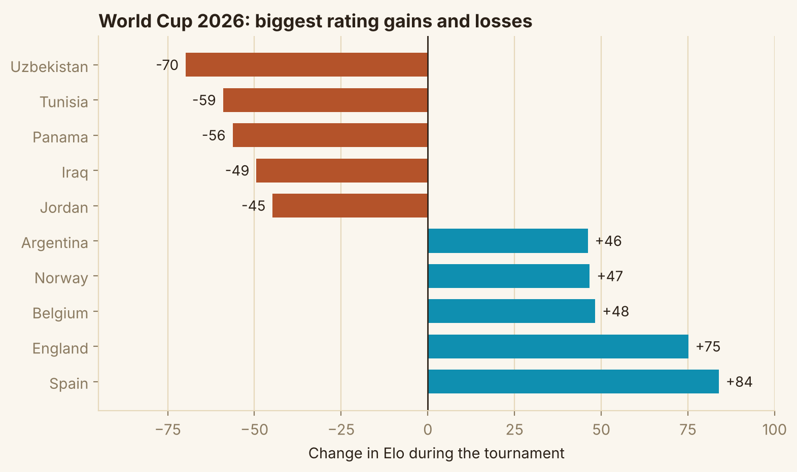
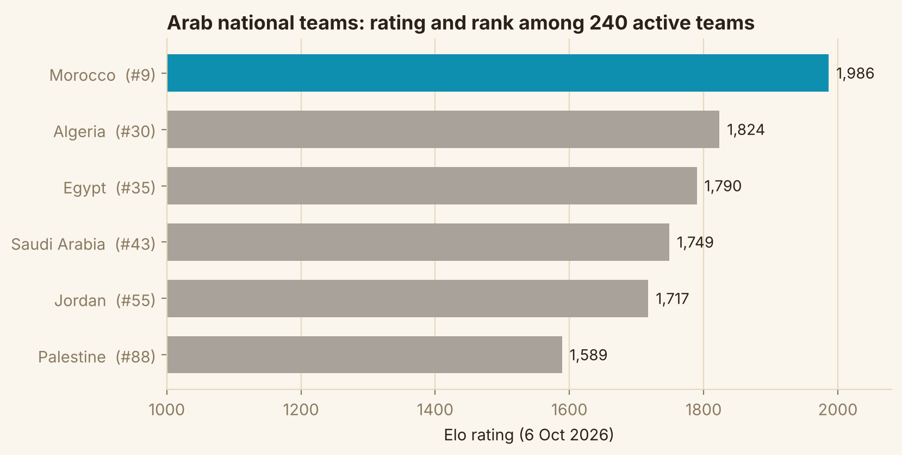

# PredictiBall: predicting international football results

How well can we predict the result of an international match (home win / draw / away win) **before** it is played, and which ingredients actually help?

Everything is in one notebook: [`PredictiBall_Full_Analysis.ipynb`](PredictiBall_Full_Analysis.ipynb) (outputs included, so you can read it on GitHub without running anything).

## Results (test period: Jan 2023 to Oct 2026, 4,098 matches the models never saw)

| Model | Accuracy | Log loss |
|---|---|---|
| Always predict a home win | 47.2% | 1.054 (class frequencies) |
| Recent form only (last 5 matches) | 53.0% | 0.982 |
| Logistic regression on Elo only | 60.7% | 0.870 |
| Logistic regression, all features | 60.9% | 0.861 |
| Random Forest | 60.9% | 0.867 |
| Gradient Boosting | 60.8% | 0.864 |
| Poisson goals model | 60.8% | 0.862 |
| Ensemble (equal-weight average) | 60.9% | 0.862 |

What the numbers say:

- The fair baseline is **47.2%** ("home team always wins"), not 50%.
- **Elo does almost all the work.** Complex models add very little, and accuracy differences between them are inside the noise (about ±0.8 points for 4,098 matches).
- On balanced matches (Elo gap of 200 or less, 2,406 matches) accuracy is about **50%**; recent form alone is no better than the baseline there.
- World Cup 2026 backtest (104 matches): 66.3% accuracy. Small sample, margin of error about ±9 points.
- Draws are never the single most likely outcome, so they are predicted as probabilities, not calls.

## Selected figures

All of these are produced by the notebook (`figures/`).

**Which ingredients help? (test period)**

**Calibration of the ensemble**

**Elo ratings: top 15 teams (6 Oct 2026)**

**Rating changes during the World Cup 2026**

**Arab national teams**

## What is inside the notebook

1. Data cleaning and exploration
2. Metrics (accuracy, log loss, Brier, RPS) and honest baselines
3. Elo ratings (basic and tuned, with date-batched updates to avoid leakage)
4. Leak-free form features (rolling windows built from earlier dates only, with a unit test on 300 random matches)
5. Time-based split: train 1990 to 2018, validation 2019 to 2022, test 2023 onward
6. Models, tuning on validation only, paired bootstrap, calibration, permutation importance
7. World Cup 2026 backtest, rating changes during the tournament, Arab teams ranking
8. `predict_match(home, away)` for any pair of teams
9. Findings, limits, next steps

## Run it yourself

1. Get the data: download `results.csv` from [martj42/international_results](https://github.com/martj42/international_results) and put it next to the notebook. (The file is not included here; check that repository for its licence and terms.)
2. `pip install -r requirements.txt`
3. `jupyter notebook PredictiBall_Full_Analysis.ipynb`

The notebook runs top to bottom in about two minutes. Set `SAVE_FIGS = True` in the setup cell to regenerate the images in `figures/`.

## Limits

- The data contains **results only**: no lineups, injuries, expected goals or betting odds.
- A single train / validation / test split is fair but not exhaustive.
- Elo ratings here are my own implementation and are not the FIFA ranking.
- This is a modelling exercise, not betting advice.

## Author

Ali Abu Salah · [LinkedIn](https://linkedin.com/in/ali-ai-ds) · [GitHub](https://github.com/AliAbuSalah1)
